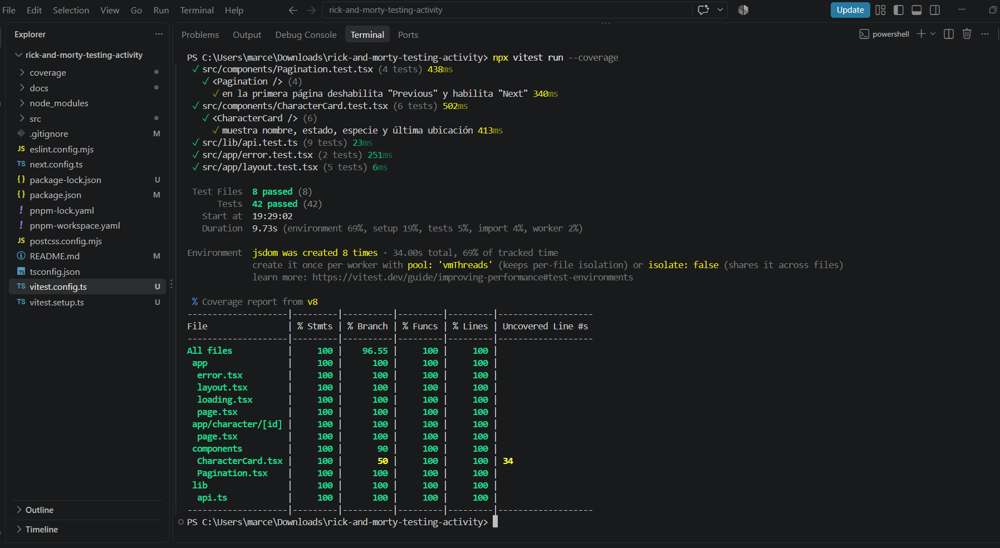

# Rick and Morty Explorer 🧪

Una aplicación web moderna para explorar el universo de Rick and Morty, construida con Next.js 15, React 19 y Tailwind CSS v4.

## 🚀 Características

- **Exploración de Personajes**: Navega a través de todos los personajes de la serie con una interfaz de cuadrícula responsive.
- **Detalle de Personaje**: Información detallada de cada personaje, incluyendo origen, ubicación y episodios.
- **Paginación**: Navegación fluida entre páginas de resultados.
- **Diseño Responsive**: Optimizado para móviles, tablets y escritorio.
- **Modo Oscuro**: Interfaz oscura por defecto con estética acorde a la serie.
- **Server-Side Rendering (SSR)**: Carga rápida y SEO optimizado gracias a Next.js App Router.

## 🛠️ Tecnologías

- **Framework**: [Next.js 15](https://nextjs.org/) (App Router)
- **Biblioteca UI**: [React 19](https://react.dev/)
- **Estilos**: [Tailwind CSS v4](https://tailwindcss.com/)
- **API**: [The Rick and Morty API](https://rickandmortyapi.com/)
- **Tipado**: TypeScript

## 📦 Instalación y Ejecución Local

1.  **Clonar el repositorio** (o descargar el código):
    ```bash
    git clone <tu-repositorio>
    cd my-app
    ```

2.  **Instalar dependencias**:
    ```bash
    npm install
    # o
    pnpm install
    # o
    yarn install
    ```

3.  **Ejecutar el servidor de desarrollo**:
    ```bash
    npm run dev
    # o
    pnpm dev
    # o
    yarn dev
    ```

4.  Abrir [http://localhost:3000](http://localhost:3000) en tu navegador.

## 🚀 Despliegue

La forma más sencilla de desplegar esta aplicación es utilizando [Vercel](https://vercel.com/new).

1.  Sube tu código a un repositorio de GitHub, GitLab o Bitbucket.
2.  Importa el proyecto en Vercel.
3.  Vercel detectará automáticamente que es un proyecto Next.js.
4.  Haz clic en **Deploy**.

## 📂 Estructura del Proyecto

- `src/app`: Rutas de la aplicación (App Router).
  - `page.tsx`: Página principal (lista de personajes).
  - `character/[id]/page.tsx`: Página de detalle de personaje.
  - `loading.tsx` / `error.tsx`: Estados de carga y error.
  - `layout.tsx`: Layout principal con Header y Footer.
- `src/components`: Componentes reutilizables (`CharacterCard`, `Pagination`).
- `src/lib`: Lógica de cliente API (`api.ts`).
- `src/types`: Definiciones de tipos TypeScript (`rickandmorty.ts`).

## ✅ Requisitos Cumplidos

- [x] Consumo de API de Personajes.
- [x] Vista de cuadrícula con imagen, nombre, estado y especie.
- [x] Paginación.
- [x] Vista de detalle con información completa.
- [x] Lista de episodios en la vista de detalle.
- [x] Enrutamiento cliente-servidor (Next.js).
- [x] Diseño Responsive.
- [x] Loading states y manejo de errores.

## 🧪 Pruebas unitarias con Vitest

Se configuró **Vitest** (con `jsdom` y Testing Library) para probar componentes, funciones utilitarias y lógica de la aplicación siguiendo el patrón **AAA** (Arrange, Act, Assert).

### Comandos

```bash
npm install            # instala dependencias (incluye Vitest)
npm test               # modo watch
npm run test:run       # una sola ejecución
npx vitest run --coverage   # ejecución + reporte de cobertura (consola y HTML)
```

### Qué se prueba

| Archivo | Qué valida |
|---|---|
| `src/lib/api.test.ts` | `getCharacters`, `getCharacter`, `getEpisodes`: URL correcta, errores de red (`fetch` simulado con `vi.stubGlobal`) y el caso en que la API devuelve un solo objeto |
| `src/components/CharacterCard.test.tsx` | Datos mostrados, enlace al detalle y color del indicador por estado |
| `src/components/Pagination.test.tsx` | Primera página, página intermedia, última página y una sola página |
| `src/app/page.test.tsx` | Página principal (Server Component async): parámetro `page`, valor por defecto y parámetro repetido |
| `src/app/character/[id]/page.test.tsx` | Detalle: datos, episodios, fecha, `type` vacío, estados y enlace de regreso |
| `src/app/error.test.tsx` | Mensaje de error, `console.error` y botón *Try again* (`reset`) |
| `src/app/loading.test.tsx` | Esqueletos de carga |
| `src/app/layout.test.tsx` | Metadata, navegación, footer y fuentes (con `next/font` simulado) |

### Cobertura

Umbral mínimo configurado en `vitest.config.ts`: **80%** en statements, branches, functions y lines (si baja de eso, el comando falla).

Resultado actual: **42 tests en verde** — Statements 100%, Branches 96.55%, Functions 100%, Lines 100%.

El reporte HTML está en [`coverage/index.html`](coverage/index.html) (se regenera con `npx vitest run --coverage`).


